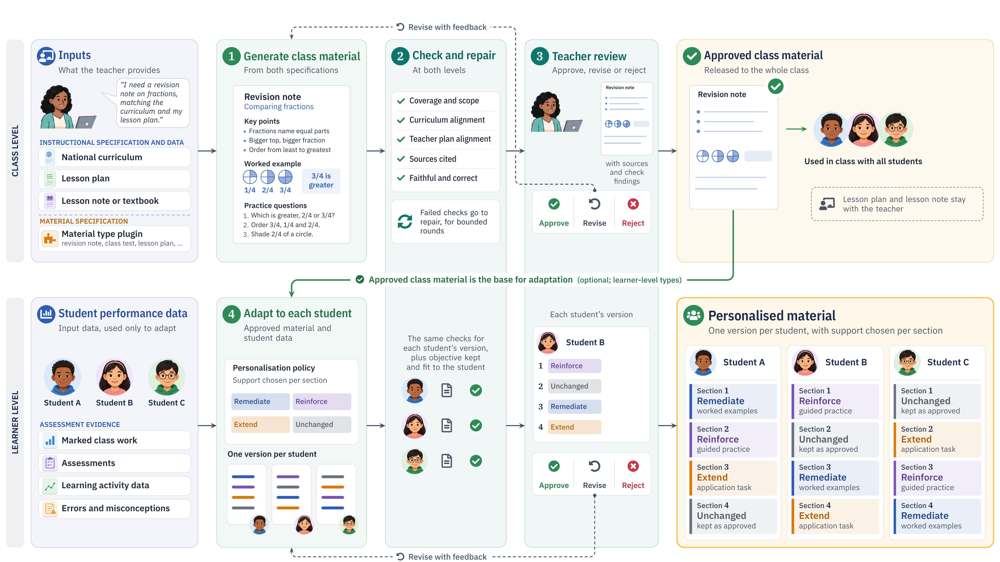

# Teacher Agent

Teacher Agent drafts lesson plans and class materials from the Nigerian curriculum, and a teacher approves each one before any learner sees it.

Entry to the ITU AI for Good Lab Hackathon (UAE, 2026).

| For judges | Where |
|---|---|
| Knowledge base: 10 official documents (data protection, education, AI strategy) | [`hackathon/Dataset/Nigeria/PolicyData/`](hackathon/Dataset/Nigeria/PolicyData/Refs.md) |
| Use-case data (curriculum, textbook) | [`hackathon/Dataset/Nigeria/UsecaseData/`](hackathon/Dataset/Nigeria/UsecaseData/) |
| ITU-T Y.3172 nodes mapped to code | [`hackathon/README.md`](hackathon/README.md) |

## Scenarios

1. A parent challenges the use of a child's results.
2. A teacher approves content that has a mistake.

## Gaps found

1. Nigerian education policy names AI-written teaching material as a concern but sets no rule for it.
2. It is unclear whether the data protection law's education exception covers an AI tool a teacher chooses.
3. The national AI strategy has no rule for AI tools that teachers use to prepare lessons.
4. There is no school-level guidance on sending learners' data to models hosted abroad.
5. ITU-T Y.3172 is silent on human oversight, decision records and personal data.
6. There is no common record format for an agent's reasoning in schools.

The technical report gives the detail.
