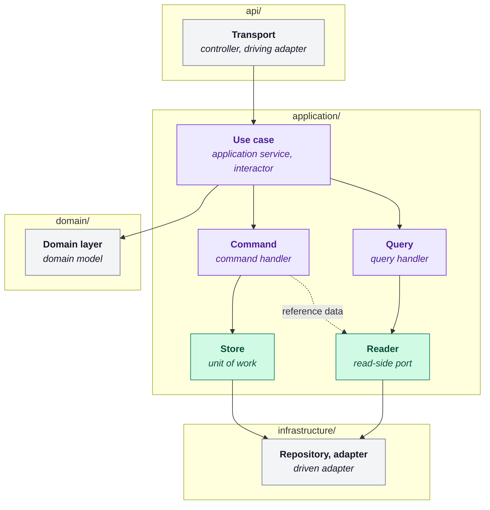

# Backend code vocabulary

This document defines the words this codebase uses for its own code shapes. Each shape has one name.

- The research and product terms (H1/H2, condition codes, focal learner, evaluation packet) are in [`docs/glossary.md`](../../../docs/glossary.md).
- One word, *policy*, has a different sense in each glossary. This document defines both senses.
- This document defines terms. These documents hold the rules:

| Document | Rules |
| --- | --- |
| [`domain-architecture-baseline.md`](domain-architecture-baseline.md) | Layer meanings and folder layout |
| [`application-boundaries.md`](application-boundaries.md) | The callable boundary, stores and readers, module granularity |
| [`persistence-boundaries.md`](persistence-boundaries.md) | Transaction ownership |
| [`code-design-rules.md`](code-design-rules.md) | When a seam, a layer or a constant is justified |

## Where code lives

**Business domain**: a top-level folder under `src/app/domains/`, for example `experiments`. It owns one
product area: transport, use cases, business rules and persistence.

**Domain layer**: the `domain/` folder inside a business domain, for example `experiments/domain/`.
It holds business meaning on plain values: invariants, transitions, classifications and
persistence-neutral records.

Write *business domain* or *domain layer* when the context does not make the sense clear.
Rules: `domain-architecture-baseline.md`.

**Subdomain**: a business boundary inside another, because it is a variant of the parent. It has its own layers.

- `artefacts/core/` holds what is true of every artefact. Each artefact kind has its own package.
- A kind can nest again for a phase, for example `lesson_plan/drafting/`.
- The target path is `artefacts/<kind>/`, for example `artefacts/lesson_note/`.
- `lesson_plan` and `post_class_review_pack` are under `artefacts/types/`. Story `ART-003` moves them (census row `artefact_types_under_a_sorting_dir`).

**Transport**: the mechanism that carries a request in and a response out, for example HTTP, a
job or CLI arguments. It parses and authenticates its envelope, calls one use case and renders
the result. It does not sequence a use case, and it does not commit.
Rules: `application-boundaries.md`.

**Composition root**: the one place that builds the concrete collaborators and gives them to a use case.

| Transport | Composition root |
| --- | --- |
| HTTP | `api/deps.py` |
| Job | the job handler, in the job process |
| CLI | `main()` |
| Tests | a fixture |

Nothing below the composition root selects an implementation.
Rules: `application-boundaries.md`.

## What an operation is

**Use case**: one business operation in `application/`. It takes one immutable input and returns
one explicit output. Its collaborators are bound at construction. Its name is the business verb,
for example `LaunchExecution`.

**Command**: a use case that changes state and commits. It takes a Store. Command is a concept,
not a class-name suffix. Rules: `application-boundaries.md`, `persistence-boundaries.md`.

**Query**: a use case that only reads. It takes Readers and no Store. A Query loads records,
builds domain values, applies domain rules and assembles an output. If a Query only forwards a
call, its logic is in `api/` or in a repository, and the rules forbid both.

- In these docs, *reads* and *writes* are persistence operations. *Query* is only the use case.
- A use case that commits gets a Store. A use case that does not commit gets Readers.

| | What it is | What it takes |
| --- | --- | --- |
| **Command** | a use case, in `application/` | a Store, and Readers for reference data |
| **Query** | a use case, in `application/` | Readers |

A Command can also take Readers. The split is by isolation:

- A read that the write decision depends on goes through a Store capability. It sees the same snapshot as the write.
- A read of reference data (a catalogue, a label, a plan version under inspection) comes from a Reader.

A use case can also take ports outside persistence, for example `SectionGenerator` or
`SectionCritic`. Repositories and adapters in `infrastructure/` implement the ports.

## What crosses a boundary

Two kinds of frozen dataclass cross the seams. Neither names a SQLAlchemy, FastAPI or DSPy type.

| Record | What it is | Changes when |
| --- | --- | --- |
| Application record | The input or output of a use case | The operation contract changes |
| Persistence-neutral record | What a Store or Reader returns | The read changes |

- A use case that returns a loaded record unchanged can use one class for both.
- An application record is not an ORM row or a Pydantic response model.
- `types.py` holds these records, domain values and protocols. It holds no Pydantic contract and no ORM class.

Rules: `application-boundaries.md`, `persistence-boundaries.md`, `domain-architecture-baseline.md`.

## What an operation depends on

**Port**: an interface that a use case depends on and infrastructure implements. The code names a
port for its role, with no `Port` suffix. Write *port* for the category and *role name* for the
identifier. The two persistence roles are Reader and Store.

- Declare a port in the module that uses it.
- Put ports that operations share in a module named for the capability: `launch_ports.py`, `rating_ports.py`.
- Do not add a domain-wide `ports.py`. See [`application-boundaries.md`](application-boundaries.md#package-and-file-granularity).

**Reader**: a read-only port for one operation. Name it for that operation, for example
`PlanApprovalReader`. Two operations with similar reads get two Readers. The consolidation
trigger is in [`application-boundaries.md`](application-boundaries.md#stores-and-readers).

**Store**: this codebase's name for the Unit of Work pattern. It owns one transaction, exposes the
capability groups inside it, and is the only place for `commit` and `rollback`. Scope it to what
one workflow commits, for example `ExecutionLaunchStore`. Do not use `UnitOfWork` or `uow` in code.

**Capability** has two senses:

| Sense | Definition | Example |
| --- | --- | --- |
| Role group | A named set of reads or writes that a Store property returns. The Store owns the transaction. | `store.ratings`, `store.executions` |
| Package | A folder under `application/` for the operations of one business capability. The conditions for one are in [`application-boundaries.md`](application-boundaries.md#package-and-file-granularity). | a folder with its own `<capability>_ports.py` |

A role group is one port in a `<capability>_ports.py` module.

A Reader and a Store capability have the same protocol shape. The difference is how a use case
gets them:

| Port | The use case gets it | Name |
| --- | --- | --- |
| Reader | as a constructor argument | `...Reader` |
| Capability | through a Store property | bare, for example `ratings` |

**Repository**: a concrete `infrastructure/` class that reads and stages writes. It does not
commit. In `store.ratings`, `ratings` is the repository and `store` is the transaction.
Rules: `persistence-boundaries.md`.

**Adapter**: a concrete port implementation in `infrastructure/`, named for its mechanism, for
example `SqlAlchemyExecutionLaunchStore` or `ExperimentRepository`. Do not use the `Adapter`
suffix. No adapter type appears in a transport signature or a use-case contract.

**Policy** has two senses:

- Code: a pure precondition on plain values, with no I/O, for example `ensure_no_generation_in_flight` in `experiments/application/launch_policy.py`.
- Thesis: a frozen config that defines an experimental condition, for example `ContextPolicy` or `RetrievalPolicy`. A `ConditionProfile` groups them. See [`glossary.md` §I](../../../docs/glossary.md#i-generation--optimisation).

## How they fit together

```text
transport            parses its own envelope, authenticates, maps to an input
  └─ use case        sequences the work and decides when to commit
       ├─ domain     answers what is allowed, on plain values
       └─ port       Reader for what it reads, Store for what it commits
            └─ adapter   SQLAlchemy, DSPy — chosen at the composition root
```

Each box shows this codebase's name, with the standard name under it. The subgraph is the layer folder.



- Store and Reader are ports, and `application/` declares them beside their callers. Only their implementations are in `infrastructure/`.
- The dashed edge is a Command that reads reference data through a Reader.
- The domain layer has no outgoing edge. It knows only its own values and records.

## Standard names

Each term is a standard pattern. Search for the right column in the DDD, hexagonal or
clean-architecture literature.

| This codebase | Standard name |
| --- | --- |
| Business domain | bounded context |
| Subdomain | nested context, module |
| Transport | controller, driving adapter |
| Composition root | composition root, DI wiring |
| Use case | application service, interactor |
| Command | command handler |
| Query | query handler |
| Application record | DTO, request/response model |
| Persistence-neutral record | read model, domain DTO |
| Port | port, gateway |
| Store | unit of work |
| Reader | read-side repository, finder |
| Capability *(role group)* | repository on the unit of work |
| Capability *(package)* | vertical slice, feature module |
| Policy | specification, policy object |
| Repository | repository |
| Adapter | driven adapter |

## Names not used

| Not used | Use instead | Why |
| --- | --- | --- |
| `Service`, `ApplicationService` | the business verb — `LaunchExecution` | names a bucket, not an operation |
| "domain service", "orchestration service" | that domain's use case | `Service` is not a shape this codebase has |
| `Manager`, `Handler`, `Helper` | the business verb, or a named policy | says nothing about what the code does |
| `Command` / `Query` suffix | the business verb | the concepts are real; the suffixes are noise |
| `UnitOfWork`, `uow` | `Store` | names the mechanism rather than the role |
| `Transaction` (as a role name) | `Store` | describes only the commit half, not the capabilities |
| `Port` suffix | the role name — `SectionGenerator`, `PlanApprovalReader` | the role name already carries it |
| `Persistence` suffix | `Store` or `Reader` | says where data goes, not what the caller needs |
| `RepositoryPort` | the role name | a port named after the adapter it hides |
| `services/`, `controllers/` | capability packages beside their caller | sorting buckets, not boundaries |
| domain-wide `ports.py` | `<capability>_ports.py` beside its callers | a whole domain is not one caller's role set |

## State of the code

The vocabulary above is the target. A story owns each gap between the target and the code.

- [`scripts/code_vocabulary_census.py`](../scripts/code_vocabulary_census.py) measures every count below. The first column is the census key.
- The census includes nested subdomains, because each subdomain has its own layers.
- To refresh the counts, run `uv run python -m scripts.code_vocabulary_census --write`.

| Group | Trend | Check |
| --- | --- | --- |
| Debt | Falls to zero | [`tests/test_code_vocabulary_census.py`](../tests/test_code_vocabulary_census.py) holds each row to its ceiling in `DEBT_CEILINGS`. |
| Population | Grows with the product | None. The script regenerates the rows. |

Rules for the tables:

- Each row is debt or population, never both.
- A debt row names its exit story in the Gap column. An open row's story must be in the backlog.
- Lower the ceiling in the change that lowers the count.
- A row at zero stays as a regression guard, with a ceiling of zero.
- The script sorts the debt rows by count, largest first, then by name.

The same shape (a measured number, a ceiling and a named owner) applies at three levels:

| Level | Measured by | Owner it must name |
| --- | --- | --- |
| One import exemption | `test_import_contract_ceilings.py` | the story that deletes it, in a `pyproject.toml` comment |
| One debt row | this table | the story that deletes it, in the Gap column |
| One sprint | `census_rows_closed` in the backlog | the rows it drives to zero |

Population — how much of each shape exists:

| Census key | Count | What it counts |
| --- | --- | --- |
| `store_protocols` | 14 | `*Store` protocols; `commit`/`rollback` restricted to these by test |
| `reader_protocols` | 48 | `*Reader` protocols |
| `bare_name_protocols` | 97 | application protocols carrying no role suffix |
| `port_modules` | 11 | modules ending `ports.py` |

Debt — what the vocabulary has not finished:

| Census key | Count | What it counts | Gap |
| --- | --- | --- | --- |
| `application_signatures_returning_orm` | 276 | public application callables naming an ORM type in their return annotation — a floor, not a total | `APP-003E` |
| `application_to_infrastructure_exemptions` | 111 | `application/` importing `infrastructure/` | `APP-003C` |
| `port_suffixed_references` | 67 | references to `Port`-suffixed names | `LANG-001` |
| `port_suffixed_files` | 25 | files holding those references | `LANG-001` |
| `duplicated_reader_signatures` | 15 | read signatures repeated across 3+ readers in one domain | `APP-003D` |
| `application_to_transport_exemptions` | 11 | `application/` importing `api/` | `APP-002H` |
| `port_suffixed_names` | 8 | classes still carrying the `Port` suffix | `LANG-001` |
| `artefact_types_under_a_sorting_dir` | 2 | artefact kinds filed under `artefacts/types/` rather than named directly | `ART-003` |
| `domain_wide_port_modules` | 2 | port modules named bare `ports.py` | `LANG-001` |
| `persistence_suffixed_protocols` | 1 | `UserOnboardingPersistence` | `LANG-001` |

Notes on four rows:

| Row | Note |
| --- | --- |
| `bare_name_protocols` | Mixes Store capabilities (`Assignments`, `AuditItems`) with caller-owned roles (`AssignmentViewData`, `ConditionRetryContextFactory`). No mechanical rule separates the two groups. |
| `application_signatures_returning_orm` | The outward ORM crossing. [`tests/test_api_does_not_import_models.py`](../tests/test_api_does_not_import_models.py) stops `api/` from importing model classes, but a route can still read an ORM row that a use case returns. The count reads only return annotations, so it is a floor: a return type that contains `Any` can hide an ORM row. Story `APP-003E` closes this direction and adds its guard. |
| `application_to_infrastructure_exemptions` | The inward direction. Story `APP-003C` closes it. |
| `duplicated_reader_signatures` | One method name with one return annotation on three or more Readers in one domain. Every current duplicate is in `experiments`, and each duplicated return type is an ORM row. |

## What the tests enforce

[`tests/test_application_protocol_architecture.py`](../tests/test_application_protocol_architecture.py) checks these rules.

Names:

- Public application names and parameters do not contain `uow`, `unitofwork` or `transaction`.
- Evaluation protocol names do not end in `Persistence` or `RepositoryPort`.
- No application module or class has `helper` in its name.
- `ExperimentRepositoryPort` and its imports are absent.

Shapes:

- Only a `*Store` protocol has `commit` or `rollback`, and it has both.
- An application protocol has ten public members or fewer.
- An evaluation protocol inherits no other protocol.

No test enforces the removal of the `Port` suffix or the split between a Reader and a capability.
